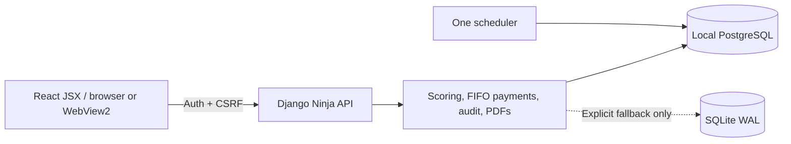

# KC Ledger

**Private single-owner financial operations console** for clients, engagements, invoices, instalment payments, expenses, work entries, goals, risk scoring, reporting and auditable financial history.

**Primary database:** local PostgreSQL 15+ or managed PostgreSQL on Vercel; **SQLite WAL:** controlled desktop-only fallback, never silently synchronized. The frontend uses React/JavaScript/JSX and Vite; backend uses Django 5.2/Ninja, APScheduler and ReportLab. The native Windows application hosts Django locally through Waitress + WebView2.

## Installable PWA and Vercel hosting

KC Ledger builds a browser-installable Progressive Web App for desktop, Android and iOS with real PNG/maskable icons, service worker, update controls and an offline static shell. **A cloud-installed PWA still needs network access to its managed Django/PostgreSQL backend for all financial data and mutations.** For fully local use, start Docker Compose Django + PostgreSQL, open `http://127.0.0.1:8080` and install that separate loopback PWA; it works without public internet while local services run. Cloud and local data do **not** synchronize automatically.

**Recommended managed free DB:** Prisma Postgres Free (currently 2 GB storage per workspace and a monthly operation limit). Standard PostgreSQL/psycopg is used, with pooled runtime URL, direct migration/backup URL and enforced TLS. Production Vercel deployment stays gated on offsite backup and tests until explicitly configured. Vercel Hobby restricts commercial use; select appropriate hosting.

- [PWA installation and offline behavior](docs/16-pwa.md)
- [Vercel + Prisma 2 GB setup and production acceptance](docs/31-pwa-vercel-prisma.md)

## Intelligence and PWA deep-hardening audit

The system now captures review outcomes as fixed, dated evidence, distinguishes unchanged metrics from real improvement, excludes future-dated cash movements, fails closed on missing FX, and records actual lead/proposal stages and won/lost outcomes. The financial advisor uses documented evidence, not invented future demand; client matching uses bounded historical candidates. The installed PWA adds authenticated cache/session isolation, visible update recovery and install guidance.

- [Detailed scope-preserving audit, applied corrections, deferred dependencies and tests](docs/32-intelligence-pwa-audit.md)

## Business-wide strategy and financial intelligence

The intelligence engine now begins with a **Business command** workspace: recorded cash movement, costs by category, project and client cash contribution, overdue exposure, multi-period trends and anomalies, owner-defined goals, tracked strategy experiments, an illustrative cash sensitivity lab and an evidence-based client pitching guide. The local deterministic advisor challenges high-risk assumptions and previous underperforming decisions before optional Gemini/Grok second opinions.

**Accounting limitation:** collected cash minus recorded expenses is **not** audited profit, bank balance or a full income statement. Models cannot approve payments, invent historical baselines, change client status or take business actions.

- [Business intelligence architecture, goal measurement, strategy evaluation and limits](docs/30-business-intelligence.md)

## Client intelligence — the primary decision-support engine

KC Ledger now combines its deterministic eight-factor client scoring with structured business-behaviour evidence, historical pattern matching, reviewable alerts and real longitudinal analytics. The primary engine runs entirely on your own PostgreSQL/SQLite ledger without model keys or network access.

The dedicated **Intelligence** navigation page includes health and risk distributions, warning frequencies, a health/risk scatter, recorded behaviour heatmap, 90-day score/risk trends, per-client radar and evidence timelines, actionable local recommendations, and reviewable cross-client pattern warnings. At least **two different shared adverse behaviours** and sufficient weighted overlap are required before creating a pattern alert. Personal identifiers and protected characteristics are never features of the comparison. Scores do not automatically blacklist clients.

**Secondary model advice:** owner opt-in Gemini (eligible free API tier) or xAI Grok (metered, disabled by default). Only de-identified coded indicators are shared per request, never client names, personal contacts or free-text notes. Models cannot change your ledger. Google ADK is intentionally not required for these restricted read-only advisories.

- [Primary intelligence, matching algorithm, API and model privacy controls](docs/28-client-intelligence.md)
- [Deep audit findings and release gates](docs/29-audit-findings.md)

## Architecture



| Layer | Stack / behavior |
| --- | --- |
| UI | React 18, JSX, Vite 8, TanStack Query, Chart.js; KC light-paper theme |
| API | Django 5.2 / Ninja, staff-only sessions, CSRF and request limits |
| Primary persistence | PostgreSQL, Django migrations, Decimal money, constraints, transactions |
| Fallback persistence | SQLite WAL, pinned per installation; no automatic failback or replication |
| Connection performance | 60-second reuse, health checks, short connect timeout, bounded queries |
| Background jobs | One APScheduler, reminder and FX tasks |
| Recovery | PostgreSQL custom-format `pg_dump/pg_restore`; SQLite online backup |
| Windows | Waitress, pywebview/WebView2, PyInstaller + Inno Setup |
| Tests | pytest/Django, real PostgreSQL CI, SQLite CI, Docker, Chromium E2E, Windows smoke |

## Releases and automatic updates

KC Ledger uses a single root [VERSION](VERSION) consumed by Node, Django and Inno Setup. Every built client and API response identifies its version, short Git SHA, build timestamp, release channel and minimum supported version. The footer displays the active build.

**Web:** CI verifies SQLite/PostgreSQL financial tests, frontend, Docker, Chromium and Windows. After an approved Vercel project is connected and its `KC_LEDGER_VERCEL_READY` flag is enabled, GitHub Actions stages production without moving the public domain, backs up and migrates the managed PostgreSQL database, validates the staged `/api/health` and `/api/version`, then promotes the tested deployment. PRs use Vercel Git previews. The production Git integration must **not auto-promote before the CI migration gate**.

**Windows:** tagged `vX.Y.Z` releases build, sign and smoke-test an Inno installer. The native app checks a GitHub Release manifest, stages a download over HTTPS, verifies SHA-256, Authenticode signer and embedded version, then requests restart. Install upgrades first back up binary files and PostgreSQL/SQLite data and preserve the user-specific `.env` and database pin. Unsigned updates are never accepted.

**External setup is required before live deployment or signed release:** Vercel project + managed PostgreSQL + scoped secrets, and a trusted Windows code-signing certificate. These are intentionally not embedded in Git.

- [Deployment, signed update and rollback runbook](docs/26-updates-and-deployment.md)
- [Update verification matrix](docs/27-update-verification.md)

## Local installation with PostgreSQL

Install PostgreSQL 15+ locally. Create a dedicated `kc_ledger` role and database, then copy `.env.example` to `.env`. Set **real secrets** for `DJANGO_SECRET_KEY`, `LEDGER_USERNAME`, `LEDGER_PASSWORD` and `LEDGER_DB_PASSWORD`. The source backend automatically loads `.env`.

```bash
python -m pip install -e ".[dev]"
python backend/manage.py db_status
python backend/manage.py migrate --noinput
python backend/manage.py ensure_owner
python backend/manage.py runserver 127.0.0.1:8000
```

The diagnostic must report **`postgresql`**, or the app is not using the intended primary database. For the React dev server, run `npm ci` then `npm run dev` in another terminal.

**Complete database setup, PowerShell guidance, safe SQLite migration, backend pinning and recovery:** [PostgreSQL & fallback runbook](docs/25-postgresql-and-fallback.md).

## Local Docker installation

```bash
docker compose up --build -d
docker compose ps
docker compose exec api python manage.py db_status
```

Open <http://127.0.0.1:8080>. Compose provisions **its own local PostgreSQL 15** on an internal network, with persisted data in `ledger_pgdata`; it is not the separately installed PostgreSQL on your Windows host. Port 5432 is not exposed. Set `LEDGER_DB_PASSWORD` in `.env` **before** first launch. Never use `docker compose down -v` on a real ledger.

**Existing SQLite volume?** The upgrade refuses to start against a new empty PostgreSQL database until legacy data is deliberately migrated and verified. See [migration steps](docs/25-postgresql-and-fallback.md). Data is not erased by this code change.

## Native Windows desktop

Build on Windows 10/11 x64 with Python 3.12, Node.js 22 and Inno Setup 6:

```powershell
powershell -ExecutionPolicy Bypass -File desktop\build_windows.ps1
```

The installed application reads local PostgreSQL settings from `%LOCALAPPDATA%\KCLedger\.env`, or the OS environment. In automatic mode, a fresh installation prefers PostgreSQL; SQLite is selected only if PostgreSQL is offline and fallback is allowed, and is then **pinned** to avoid split ledgers. Existing SQLite installations stay on their current data until migrated. The packaged app does not require separately installed Python/Node/Docker. PostgreSQL-mode backups require installed `pg_dump/pg_restore` tools.

## Health and verification

```bash
python backend/manage.py db_status
python backend/manage.py check
python backend/manage.py makemigrations --check --dry-run
pytest -q
ruff check backend
ruff format --check backend
npm run verify:source
npm run lint
npm run build
```

The `/api/health` endpoint tests the configured database connection and returns HTTP **503** when it is unavailable. CI separately tests SQLite and **real PostgreSQL**, verifies DB migrations/backups, checks Docker/Chromium financial flows and packages Windows. A green CI build does not establish access to your own local PostgreSQL or confirm a clean Windows installer acceptance test.

## Documentation

- [Installation](docs/01-setup.md) · [Architecture](docs/02-architecture.md) · [Data model](docs/03-data-model.md)
- [PostgreSQL connection, fallback and SQLite migration](docs/25-postgresql-and-fallback.md)
- [API](docs/07-api.md) · [Design](docs/08-design-system.md) · [Troubleshooting](docs/20-troubleshooting.md)
- [Readiness runbook](docs/21-production-readiness.md) · [Windows packaging](docs/23-windows-desktop.md)
- [Verification matrix](docs/24-verification-matrix.md) · [Historical specification](docs/00-master-spec.md)

## Copyright and governance

Private financial records, owner credentials, database files, PostgreSQL passwords and `.env` must never enter Git. Changes go to `perez` and are merged into `main` after CI verification. Software is **proprietary**; see [LICENSE](LICENSE). Repository visibility and data access must be managed separately.
