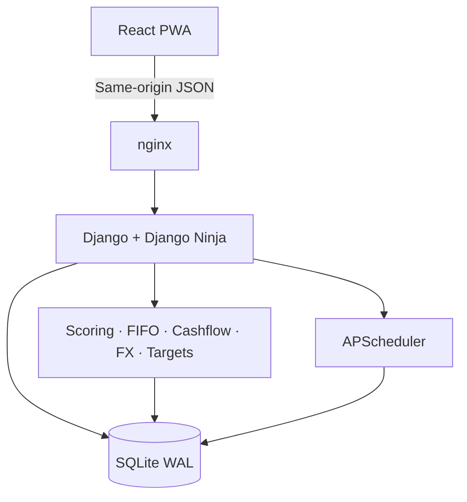

# KC Ledger

Private financial operations console for a solo freelance developer. KC Ledger records client engagements, invoices, payments, instalment plans and business events, then turns those records into explainable client-health scores and actionable financial intelligence.

> **Private application.** Do not expose it to the public internet without a reviewed deployment and access-control plan. Do not use the fictional demo records as real financial data.

## What it does

- **Financial dashboard** — collected revenue, outstanding and overdue balances, expenses, receivables aging, invoice status and client revenue concentration.
- **Client intelligence** — explainable 0–100 score across eight factors, penalties, payment history and audit timeline.
- **Invoices and payments** — invoice lifecycle, payment recording, transactional FIFO allocation and score recalculation.
- **Instalment plans** — generated schedules with Perfect, Late, In progress, At risk and Broken verdicts.
- **Avoid dossiers** — low-scoring or blacklisted clients with recorded risk flags.
- **Audit trail** — append-only event history for financial and relationship events.
- **Persistent widgets** — clock, due-date calendar, currency converter and target tracker.
- **PWA** — installable shell with static-asset caching; financial API responses are not cached offline.
- **Background jobs** — instalment state transitions, reminders, communication-silence signals, recurring retainer drafts and optional FX refresh.

## Stack

| Layer | Technology |
|---|---|
| Backend | Django 5.2, Django Ninja |
| Database | SQLite with WAL, foreign keys and busy timeout |
| Frontend | React 18, TypeScript, Vite |
| Server state | TanStack Query v5 |
| Forms | React Hook Form, Zod and native validated forms |
| Charts | Chart.js 4 / react-chartjs-2 |
| UI | Custom Terminal Ledger tokens, shadcn/Radix primitives |
| Jobs | APScheduler |
| PWA | vite-plugin-pwa / Workbox |
| Runtime | Docker Compose, Gunicorn, nginx |

## Architecture



Financial data has one source of truth: the server database. Client detail is served as a view-shaped response, scoring functions are deterministic and side-effect free, and meaningful changes create audit events.

## Quick start

1. Copy `.env.example` to `.env`.
2. Before starting, set:
   - `DJANGO_SECRET_KEY` to a random secret of at least 40 characters.
   - `LEDGER_USERNAME` to the private owner username.
   - `LEDGER_PASSWORD` to a unique password of at least 16 characters.
   - `DJANGO_ALLOWED_HOSTS` to the intended hostnames.
   - `COOKIE_SECURE=1` when HTTPS terminates in front of the app.
3. Build and start the stack:

   ```bash
   docker compose up --build -d
   docker compose logs -f api
   ```

4. Open [http://localhost:8080](http://localhost:8080). The initial owner account is created from the environment on first startup. Its password is not reset on subsequent starts.
5. For a fictional local dataset only:

   ```bash
   docker compose exec api python manage.py seed_demo
   ```

The first startup applies the checked-in Django migrations and collects static files. Never commit `.env`, the SQLite volume, backup files or real client data.

## Local development

Backend:

```bash
python -m venv .venv
# Activate the virtual environment, then:
pip install -e ".[dev]"
python backend/manage.py migrate
python backend/manage.py runserver
```

Frontend:

```bash
npm install
npm run dev
```

Vite serves the frontend on port 5173 and proxies `/api` to `http://127.0.0.1:8000`.

## Validation

```bash
pytest
ruff check backend
npm run lint
npm run build
```

Run desktop and mobile smoke tests after code changes. Main is not considered release-ready until backend tests, lint, frontend production build, manual route checks and backup/restore verification pass in an environment with the required dependencies.

## Backup and recovery

Create a consistent SQLite backup:

```bash
docker compose exec api python manage.py backup_ledger
```

Backups are integrity-checked and the newest 14 daily backup files are retained. Keep a copy outside the host and periodically test restoring it. See [troubleshooting](docs/20-troubleshooting.md).

## Documentation

Start with the [canonical master specification](docs/00-master-spec.md), then read [setup](docs/01-setup.md), [architecture](docs/02-architecture.md), [data model](docs/03-data-model.md), [scoring](docs/05-scoring-engine.md), [instalments](docs/06-instalment-engine.md), [API](docs/07-api.md) and [version control](docs/18-version-control.md).

## Version control

Two branches only: `perez` for development and `main` for deployable work. No CI workflows. See [the workflow contract](docs/18-version-control.md).

## License

Private. Not for redistribution. See [LICENSE](LICENSE).
