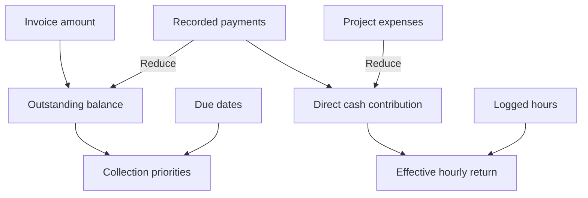
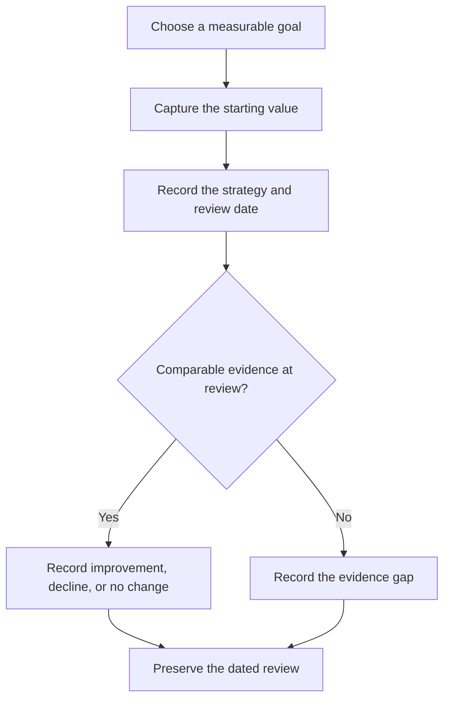

# KC Ledger

KC Ledger is a private financial operations and decision-support system for an owner-run service business. It connects the commercial history of a client relationship—what was proposed, delivered, billed, and paid—with the hours and expenses behind the work.

A large contract can keep a business busy for weeks while contributing little cash. KC Ledger gives the owner enough detail to see why. An unpaid instalment calls for a collections conversation. Repeated revisions that consume the project budget call for a different scope or price on the next proposal.

## The economics of a single engagement

Suppose a project was invoiced at **UGX 2,000,000**. The client has paid **UGX 800,000**, the owner has recorded **UGX 200,000** in direct expenses, and the work has taken **20 hours**. Three figures describe three different aspects of that engagement.

| Business question | Result to date | How to read it |
| --- | ---: | --- |
| How much does the client still owe? | UGX 1,200,000 | The invoice balance. Its due dates determine how much is overdue. |
| How much cash has the work contributed? | UGX 600,000 | Receipts less recorded direct expenses. Shared overhead and the owner's labour still matter when assessing profit. |
| What has each recorded hour returned? | UGX 30,000/hour | Cash contribution divided by logged hours. A later payment or another day of work changes the figure. |

The figures above are illustrative. The diagram shows which records support each calculation.

## What the owner can see

**Sales and delivery.** Opportunities retain their lead source, quoted value, next action, and eventual win or loss. Engagements carry the hours, expenses, and invoices for the work itself. This separation lets the owner review how proposals performed while counting cash only when a payment is recorded.

**Collections and client relationships.** Instalment schedules, reminders, and PDF statements support follow-up. An eight-factor client score draws on payment speed, overdue exposure, repeat work, and other recorded signals. The underlying history helps the owner distinguish a first missed deadline from a pattern worth considering before extending payment terms again.

**The business as a whole.** Business Command brings receipts, costs, overdue balances, and payer concentration into one view. The owner can see when a strong month depended on one client, examine which expense category increased, or explore how a change in collections would affect cash. Scenarios describe the consequences of an assumption. Sales outcomes come from recorded wins and losses.

## How a strategy is reviewed

An owner who wants to reduce overdue balances can record the current amount, choose a change in payment terms, and set a review date. The review preserves the evidence available on that date. A payment arriving the following week updates the live ledger while the earlier assessment keeps its original figures.

The core analysis runs on explicit rules and ledger evidence. Optional AI advice uses de-identified indicators with the owner's consent. Pricing, client terms, and financial decisions remain with the owner.

## Integrity and privacy

A payment, its instalment allocations, the invoice update, and the audit event are recorded together in one database transaction. Paid amounts are allocated to the earliest unpaid instalments first. Archiving a client preserves its historical contribution, so past business performance remains visible as the active client list changes.

Access to the workspace is restricted to the owner. Private financial responses stay out of the browser's offline cache. Timestamped database snapshots support recovery to an earlier saved state.

[Client scoring and evidence](docs/architecture/client-intelligence.md) · [Business intelligence and financial measures](docs/architecture/business-intelligence.md)

Copyright © 2026 KC. All rights reserved. [Proprietary license](LICENSE)
