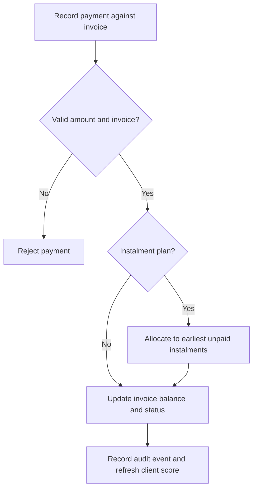
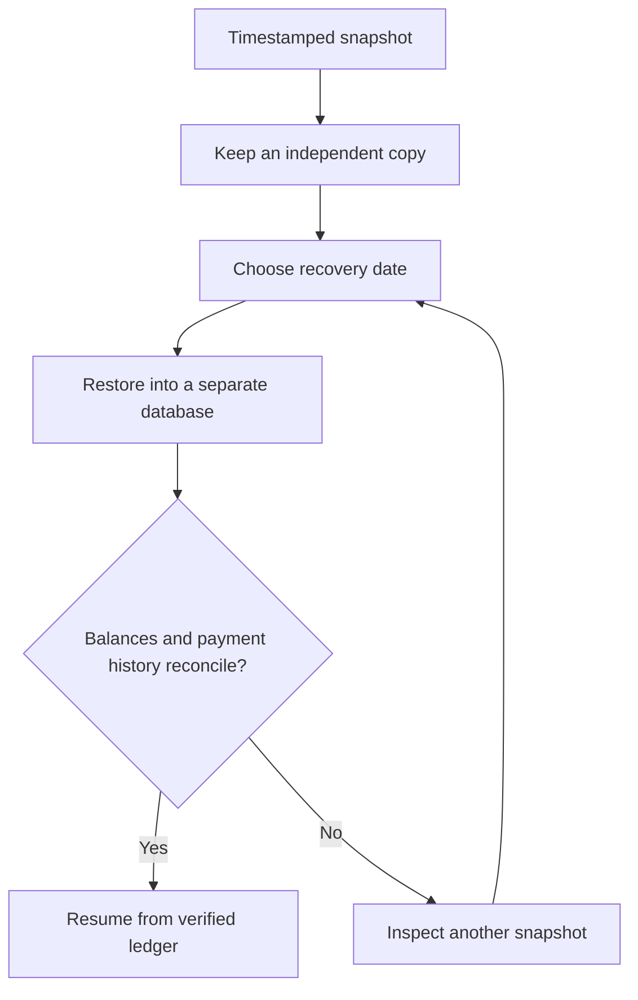

# KC Ledger

KC Ledger helps a single business owner answer three questions: **Who owes me money? Which work earns its keep? What should I follow up on next?** It connects clients, work, invoices, payments, and expenses in one private financial workspace.

## Run it locally

For a first installation on one computer, use Docker Compose. It starts the web app, Django API, and PostgreSQL together. The app remains usable without public internet while these services are running.

1. Install Docker with Compose. From the repository root, copy `.env.example` to `.env`.
2. In `.env`, set `LEDGER_USERNAME` and a unique `LEDGER_PASSWORD` of at least 16 characters. Set a separate `LEDGER_DB_PASSWORD` and a random `DJANGO_SECRET_KEY` of at least 40 characters. Choose your reporting currency and time zone.
3. Start the services and check which database the app is using.

```sh
docker compose up --build -d
docker compose ps
docker compose exec api python manage.py db_status
```

Once the services are healthy and the database reports `postgresql`, open [KC Ledger on localhost](http://127.0.0.1:8080) and sign in with your owner credentials. You can install the app from a supported browser. To shut down and keep your ledger, use `docker compose stop`. The `down -v` option deletes the database volume.

**Already have a SQLite ledger?** Follow the migration and verification steps before switching databases. [Database setup and migration](docs/25-postgresql-and-fallback.md)

## Day-to-day operations

| When you want to… | Use KC Ledger to… |
| --- | --- |
| Follow up on a lead | Track the proposal stage, quoted value, next action, and actual win or loss. A won opportunity stays in the sales pipeline until you separately record the financial work. |
| Bill a client | Record an engagement, issue an invoice, agree an instalment schedule, and export a PDF statement. |
| Chase outstanding money | Review overdue invoices, upcoming instalments, reminders, and payment history. |
| See which work pays | Log hours and expenses against engagements. Compare collected cash, recorded costs, and effective hourly rates. |
| Decide what to do next | Review client risk signals, cash trends, and concentration. Set a goal, record a strategy, and compare the outcome with its original baseline. |

### What happens when you record a payment



The API applies these changes in one database transaction. A payment that exceeds the outstanding balance is rejected. Written-off invoices cannot receive payments.

### How to read the intelligence

The **client score** uses eight factors, including payment speed, overdue exposure, and instalment discipline. You can inspect the underlying evidence and review alerts about shared patterns across clients. The core analysis runs locally. Optional Gemini or Grok advice requires owner opt-in and uses de-identified indicators. [Client intelligence](docs/28-client-intelligence.md)

**Business Command** calculates cash contribution from collected payments less recorded expenses. Use it to understand cash performance; a formal profit-and-loss statement requires additional accounting records. Strategy reviews preserve their dated outcomes. Sales win share appears after five closed opportunities and describes observed results. [Business intelligence](docs/30-business-intelligence.md)

## Where your data lives

| Installation | Authoritative database | Connectivity |
| --- | --- | --- |
| Local Docker / installed browser app | PostgreSQL in a persistent Docker volume | Financial operations work while local services run. |
| Hosted browser / installed browser app | Managed PostgreSQL behind the Django API | The interface can open offline. Reading or changing financial records requires a connection to the server. |
| Native Windows desktop | Local PostgreSQL, or SQLite when selected and pinned | The desktop app hosts Django locally. PostgreSQL installations require the local database service. |

Local and hosted installations maintain separate ledgers. Choose one as your business record. The browser caches the app interface, keeps private API responses out of its offline cache, and verifies the owner session on reconnect.

[Windows installation](docs/23-windows-desktop.md) · [Hosted deployment](docs/31-pwa-vercel-prisma.md) · [PWA behaviour](docs/16-pwa.md)

## Backups and recovery

Create a timestamped snapshot of a running Compose ledger with:

```sh
docker compose exec api python manage.py backup_ledger
```

Compose writes snapshots to `/app/data/backups` in its data volume. The command retains the **14 most recent primary snapshots** by default. PostgreSQL uses a custom-format dump; SQLite uses its online backup API and checks database integrity. For protection against device loss, schedule the command and copy snapshots to independent, protected storage. A secondary directory must be accessible and writable from the runtime that creates the backup.



`restore_ledger` defaults to validation only. For PostgreSQL, this checks that the archive catalogue is readable. A full restore drill verifies that the data can actually be recovered. Applying an in-place restore requires stopping the app and explicitly confirming replacement. The command takes a pre-restore safety snapshot of a readable target. If the original database is corrupt, preserve it and recover into a fresh database. Restoring a snapshot returns the whole ledger to the time it was taken.

Windows upgrades also checkpoint the previous program and database before replacement. [Database recovery](docs/25-postgresql-and-fallback.md) · [Release and upgrade rollback](docs/26-updates-and-deployment.md)

## Development

The frontend uses React, JavaScript/JSX, and Vite. Django and Django Ninja own authentication, financial transactions, and reporting. For source development, use the setup guide. The verification matrix covers backend tests, PostgreSQL integration, the frontend build, Docker, Chromium workflows, and Windows packaging.

[Source setup](docs/01-setup.md) · [Architecture](docs/02-architecture.md) · [API](docs/07-api.md) · [Verification matrix](docs/24-verification-matrix.md)

Copyright © 2026 KC. All rights reserved. [Proprietary license](LICENSE)
