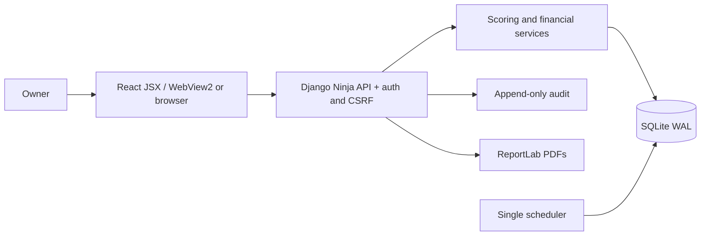
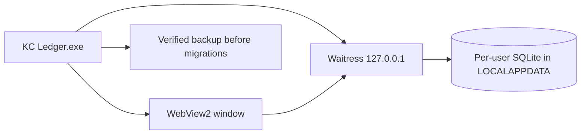

# KC Ledger

**A private financial operations console for one owner.** Record clients, engagements, invoices, instalment plans, payments, expenses and work hours; evaluate client profitability and risk; track goals; maintain an append-only audit history. There is no SaaS multi-tenancy.

**Implementation as of 15 November 2026:** React 18 with **JavaScript/JSX**, Django 5.2 + Ninja, SQLite WAL, ReportLab PDFs and a Windows native WebView2 host. TypeScript and WeasyPrint are no longer used in the current source. The codebase and its automated checks are not a substitute for real-device release acceptance.

## Technology

| Layer | Implemented technology |
| --- | --- |
| Frontend | React 18, JSX, Vite 8, TanStack Query, Chart.js, Framer Motion |
| UI | KC light paper: navy `#0B1B3D`, cyan `#2CB4E8`, yellow `#F4C543`, gold `#D7A72A` |
| API | Django 5.2, Django Ninja, staff cookies and CSRF |
| Persistence | SQLite WAL, migrations, foreign keys, transactional money allocation, soft archives |
| Jobs | Single APScheduler instance |
| Exports | ReportLab PDF |
| Browser runtime | Docker Compose, Gunicorn, nginx, localhost-bound |
| Windows runtime | Python 3.12, Waitress, pywebview/WebView2, PyInstaller, Inno Setup |
| Verification | pytest, Ruff, ESLint, Vite, audit, Docker boot, Chromium E2E, Windows smoke |

## System flow





## Run in Docker (browser)

Copy `.env.example` to `.env`. Configure a unique `DJANGO_SECRET_KEY` (40+ characters), `LEDGER_USERNAME` and `LEDGER_PASSWORD` (16+ characters). Never commit that file.

```bash
docker compose up --build -d
docker compose ps
```

Open <http://127.0.0.1:8080>. The app is deliberately bound to host loopback, **not the public network**. The owner is created once on first initialization; later environment changes do not reset existing credentials. Use `docker compose logs -f api` for troubleshooting. To populate disposable fictional data only: `docker compose exec api python manage.py seed_demo`.

## Windows desktop

On **Windows 10/11 x64**, with Python 3.12, Node.js 22 and Inno Setup 6 installed on the **build machine**, run:

```powershell
powershell -ExecutionPolicy Bypass -File desktop\build_windows.ps1
```

Output is the PyInstaller executable and, when Inno Setup is available, an installer under `installer-output/`. Installed KC Ledger requires no separately installed Node, Python or Docker; WebView2 is required (a signed Microsoft bootstrapper is bundled). On first launch an owner setup dialog creates credentials. Financial data, logs and backups are retained in `%LOCALAPPDATA%\KCLedger`. **Do not distribute as a trusted signed release until clean-Windows installation, upgrade, recovery and code-signing checks are complete.**

## Verify and release

```bash
python -m pip install -e ".[dev]"
python backend/manage.py check
python backend/manage.py makemigrations --check --dry-run
pytest -q
ruff check backend
ruff format --check backend
npm ci
npm run verify:source
npm run lint
npm run build
```

The GitHub Actions pipeline additionally checks dependencies, launches Docker, exercises Chromium owner/financial journeys and builds/smoke-tests a packaged Windows executable. The last *pre-hardening* merged base was green on [2026-11-15](https://github.com/PerezChris99/kc-ledger/actions/runs/43716306301); inspect the **latest** commit status before trusting subsequent changes.

**Release acceptance still needs:** clean Windows interactive installation, first-run and upgrade journeys, signed installer, restore drill, off-device backup policy, actual external FX-provider verification and accessible real-device UX. Green CI is not proof of 100% correctness.

## Documentation

- [Setup and developer workflow](docs/01-setup.md)
- [Implemented architecture](docs/02-architecture.md)
- [API routes and financial invariants](docs/07-api.md)
- [Current KC light-paper design](docs/08-design-system.md)
- [Backlog and release gates](docs/19-backlog.md)
- [Troubleshooting and restore](docs/20-troubleshooting.md)
- [Security, production and release runbook](docs/21-production-readiness.md)
- [Windows packaging](docs/23-windows-desktop.md)
- [Evidence and verification matrix](docs/24-verification-matrix.md)
- [Original 2026-10-28 master specification (historical)](docs/00-master-spec.md)

## Source control and licensing

Commit changes on `perez`, review the CI checks, merge into `main`, and sync `perez` to the merge commit. The repository is **currently public** despite its proprietary [LICENSE](LICENSE); keep all secrets, customer data and credentials out of version control. Ownership and copyright restrictions are separate from GitHub visibility.

Copyright © 2026 KC. Proprietary software. See [LICENSE](LICENSE).
