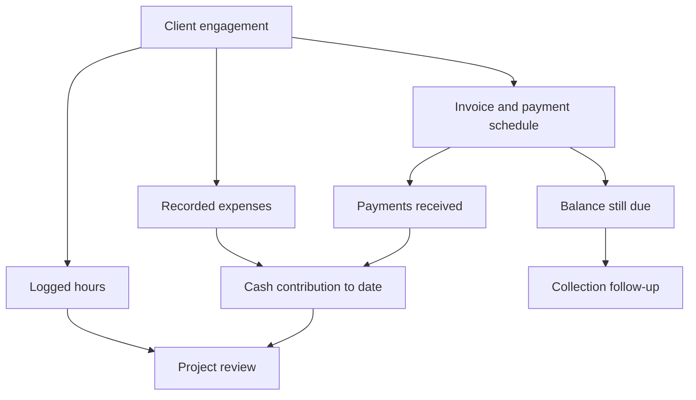

# KC Ledger

KC Ledger is a private financial operations system built for one owner running a service business. It follows the work from the first proposal through delivery and collection, bringing the client relationship, hours worked, expenses, and payments into one business record.

## The problem it solves

An invoice shows what a client agreed to pay. A bank statement shows what arrived. Neither tells the owner how much work went into the job, whether a late payment is unusual for that client, or how much cash the project has contributed so far. When those answers live in spreadsheets, messages, and memory, even deciding whom to follow up with can mean reconstructing months of work.

Consider an illustrative project billed at **UGX 2,000,000**. The client has paid **UGX 800,000**, and the owner has recorded **UGX 200,000** in project expenses. KC Ledger can show **UGX 1,200,000 still owed** alongside **UGX 600,000 in cash contribution to date**. The payment schedule tells the owner when the balance is due. Logged hours add the context needed to judge whether similar work is worth taking on again. Formal profit reporting requires a fuller accounting of the business’s costs and obligations.

## From a proposal to a business decision

| Part of the business | What KC Ledger brings together |
| --- | --- |
| Sales | Lead sources, proposal stages, quoted amounts, next actions, and won or lost outcomes. A quote, an issued invoice, and a collected payment each have their own place in the record. |
| Client work | Engagements, time entries, and expenses connect the price of a job to the effort and cost of delivering it. |
| Collections | Invoices, instalment schedules, partial payments, due dates, and write-offs explain each outstanding balance. Statements give the owner a record to use in a payment conversation. |
| Business planning | Cash trends, spending categories, overdue amounts, and dependence on individual clients help the owner decide where to focus. Goals and dated strategy reviews preserve what the owner tried and what happened afterward. |

## How the intelligence works

**Client intelligence** uses eight scoring factors, including payment speed, outstanding debt, repeat business, and instalment history. An owner reviewing a late payer can examine the underlying events and see whether the delay is isolated or part of a recurring pattern. Cross-client alerts highlight shared, documented behaviours for human review.

**Business Command** looks across the ledger. It can surface rising costs, a growing overdue balance, or a concentration of receipts from one client. The owner can explore a cash scenario, choose a strategy, and review it against a recorded baseline. A completed review retains the figures available on its review date, so later payments cannot rewrite the original conclusion.

The core analysis uses explicit rules and the owner’s recorded evidence. Optional external AI advice uses de-identified indicators with the owner’s consent. Decisions about pricing, payment terms, and future work stay with the owner.

## Financial history and privacy

Recording a payment updates the invoice, allocates money to scheduled instalments where applicable, and records the audit event in one transaction. Timestamped database snapshots support recovery to an earlier saved state. Access to the financial workspace is restricted to the owner, and the browser keeps private ledger responses out of its offline cache.

Copyright © 2026 KC. All rights reserved. [Proprietary license](LICENSE)
