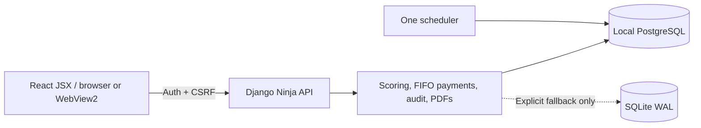

# KC Ledger

**Private single-owner financial operations console** for clients, engagements, invoices, instalment payments, expenses, work entries, goals, risk scoring, reporting and auditable financial history.

**Primary database:** local PostgreSQL 15+; **SQLite WAL:** safe fallback, never silently synchronized. The frontend uses React/JavaScript/JSX and Vite; backend uses Django 5.2/Ninja, APScheduler and ReportLab. The native Windows application hosts Django locally through Waitress + WebView2.

## Architecture



| Layer | Stack / behavior |
| --- | --- |
| UI | React 18, JSX, Vite 8, TanStack Query, Chart.js; KC light-paper theme |
| API | Django 5.2 / Ninja, staff-only sessions, CSRF and request limits |
| Primary persistence | PostgreSQL, Django migrations, Decimal money, constraints, transactions |
| Fallback persistence | SQLite WAL, pinned per installation; no automatic failback or replication |
| Connection performance | 60-second reuse, health checks, short connect timeout, bounded queries |
| Background jobs | One APScheduler, reminder and FX tasks |
| Recovery | PostgreSQL custom-format `pg_dump/pg_restore`; SQLite online backup |
| Windows | Waitress, pywebview/WebView2, PyInstaller + Inno Setup |
| Tests | pytest/Django, real PostgreSQL CI, SQLite CI, Docker, Chromium E2E, Windows smoke |

## Local installation with PostgreSQL

Install PostgreSQL 15+ locally. Create a dedicated `kc_ledger` role and database, then copy `.env.example` to `.env`. Set **real secrets** for `DJANGO_SECRET_KEY`, `LEDGER_USERNAME`, `LEDGER_PASSWORD` and `LEDGER_DB_PASSWORD`. The source backend automatically loads `.env`.

```bash
python -m pip install -e ".[dev]"
python backend/manage.py db_status
python backend/manage.py migrate --noinput
python backend/manage.py ensure_owner
python backend/manage.py runserver 127.0.0.1:8000
```

The diagnostic must report **`postgresql`**, or the app is not using the intended primary database. For the React dev server, run `npm ci` then `npm run dev` in another terminal.

**Complete database setup, PowerShell guidance, safe SQLite migration, backend pinning and recovery:** [PostgreSQL & fallback runbook](docs/25-postgresql-and-fallback.md).

## Local Docker installation

```bash
docker compose up --build -d
docker compose ps
docker compose exec api python manage.py db_status
```

Open <http://127.0.0.1:8080>. Compose provisions **its own local PostgreSQL 15** on an internal network, with persisted data in `ledger_pgdata`; it is not the separately installed PostgreSQL on your Windows host. Port 5432 is not exposed. Set `LEDGER_DB_PASSWORD` in `.env` **before** first launch. Never use `docker compose down -v` on a real ledger.

**Existing SQLite volume?** The upgrade refuses to start against a new empty PostgreSQL database until legacy data is deliberately migrated and verified. See [migration steps](docs/25-postgresql-and-fallback.md). Data is not erased by this code change.

## Native Windows desktop

Build on Windows 10/11 x64 with Python 3.12, Node.js 22 and Inno Setup 6:

```powershell
powershell -ExecutionPolicy Bypass -File desktop\build_windows.ps1
```

The installed application reads local PostgreSQL settings from `%LOCALAPPDATA%\KCLedger\.env`, or the OS environment. In automatic mode, a fresh installation prefers PostgreSQL; SQLite is selected only if PostgreSQL is offline and fallback is allowed, and is then **pinned** to avoid split ledgers. Existing SQLite installations stay on their current data until migrated. The packaged app does not require separately installed Python/Node/Docker. PostgreSQL-mode backups require installed `pg_dump/pg_restore` tools.

## Health and verification

```bash
python backend/manage.py db_status
python backend/manage.py check
python backend/manage.py makemigrations --check --dry-run
pytest -q
ruff check backend
ruff format --check backend
npm run verify:source
npm run lint
npm run build
```

The `/api/health` endpoint tests the configured database connection and returns HTTP **503** when it is unavailable. CI separately tests SQLite and **real PostgreSQL**, verifies DB migrations/backups, checks Docker/Chromium financial flows and packages Windows. A green CI build does not establish access to your own local PostgreSQL or confirm a clean Windows installer acceptance test.

## Documentation

- [Installation](docs/01-setup.md) · [Architecture](docs/02-architecture.md) · [Data model](docs/03-data-model.md)
- [PostgreSQL connection, fallback and SQLite migration](docs/25-postgresql-and-fallback.md)
- [API](docs/07-api.md) · [Design](docs/08-design-system.md) · [Troubleshooting](docs/20-troubleshooting.md)
- [Readiness runbook](docs/21-production-readiness.md) · [Windows packaging](docs/23-windows-desktop.md)
- [Verification matrix](docs/24-verification-matrix.md) · [Historical specification](docs/00-master-spec.md)

## Copyright and governance

Private financial records, owner credentials, database files, PostgreSQL passwords and `.env` must never enter Git. Changes go to `perez` and are merged into `main` after CI verification. Software is **proprietary**; see [LICENSE](LICENSE). Repository visibility and data access must be managed separately.
