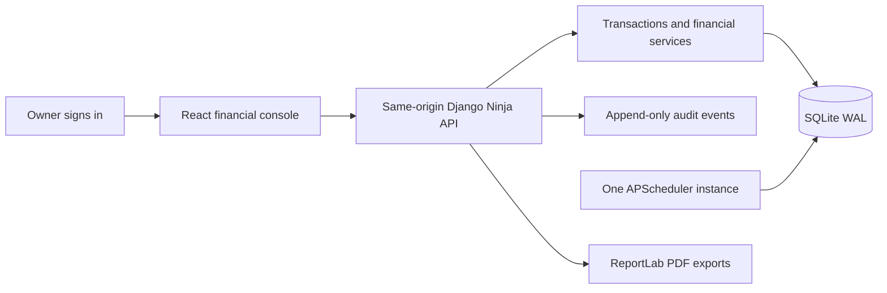
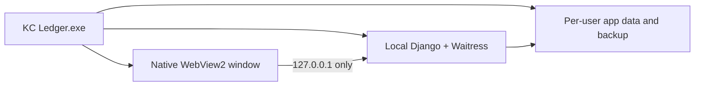

# KC Ledger

**Private-by-design financial operations console for a solo developer.** Tracks client health, engagements, invoices, payments, instalment plans, cash flow, expenses, time entries, financial targets and an append-only audit history.

> This software is proprietary. Its GitHub repository visibility must be configured separately from its application authentication and copyright license. Do not bind the local server to a public network.

## Technology

| Layer | Stack |
|---|---|
| Frontend | React 18, JavaScript (JSX), Vite 8, TanStack Query, Chart.js |
| Styling | KC light-paper design tokens, navy `#0B1B3D`, cyan `#2CB4E8`, gold `#D7A72A` |
| API | Django 5.2, Django Ninja, cookie-based staff authentication and CSRF |
| Database | SQLite WAL, foreign keys, migrations, transactional allocation, soft deletion |
| Scheduled jobs | APScheduler (single instance only) |
| PDF reports | ReportLab (no GTK/Cairo dependency) |
| Browser runtime | nginx, Gunicorn, Docker Compose (localhost-bound) |
| Windows runtime | Python/Waitress, pywebview with WebView2, PyInstaller, Inno Setup |
| Quality gates | pytest, Ruff, JavaScript (JSX), ESLint, dependency audits, Chromium Playwright, Windows packaged executable smoke |

## System flow



### Windows desktop flow



## Run locally in a browser

This route requires Docker Desktop, not the Windows installer.

1. Copy `.env.example` to `.env` and set a unique `DJANGO_SECRET_KEY` (40+ characters), `LEDGER_USERNAME` and `LEDGER_PASSWORD` (16+ characters). Keep the file out of Git.
2. Run `docker compose up --build -d`.
3. Open **http://localhost:8080**. The first owner is created from your environment. Subsequent restarts do not reset their password.

Use `docker compose logs -f api` for startup issues. Only seed fictional data when explicitly testing: `docker compose exec api python manage.py seed_demo`.

## Windows installer and native desktop

The source includes `desktop/main.py`, a Windows build script and an Inno Setup installer specification. The packaged runtime keeps the database, signing key, logs and backups in `%LOCALAPPDATA%\\KCLedger`, outside the installation folder. It binds its web server only to `127.0.0.1`; normal use needs neither Node.js nor Docker. A first-run owner setup dialog creates the credentials.

**Build on a Windows build host with Python 3.12, Node.js 22, Inno Setup 6:**

```powershell
powershell -ExecutionPolicy Bypass -File desktop\build_windows.ps1
```

The builder runs `npm ci`, creates the Vite build, packages Python with PyInstaller, verifies Microsoft's signed WebView2 prerequisite, and invokes Inno Setup. Clean-Windows installation, restart, uninstall, native WebView2 interaction and code signing must be verified separately before distributing this as a production release. Details: [Windows desktop guide](docs/23-windows-desktop.md).

## Validation and CI

```bash
python -m pip install -e ".[dev]"
DJANGO_SECRET_KEY=<your-unique-secret> pytest -q
ruff check backend
ruff format --check backend
npm ci
npm run lint
npm run build
npx playwright test
```

GitHub Actions checks backend, frontend, Docker, Chromium browser journeys, npm/Python advisories and Windows packaging. Python hashes are committed in `requirements-linux.lock` (dev+tests) and `requirements-prod.lock` (production); npm dependencies are in `package-lock.json`. **A compiled installer is not equivalent to a verified clean-Windows installation.** Inspect the latest CI run before release. No release should be tagged until the complete release checklist passes.

## Backups and restore

Create a consistent, integrity-checked SQLite backup:

```bash
docker compose exec api python manage.py backup_ledger
```

For a restore, first stop all application processes and work on a copy of your database. Validate the snapshot with `python backend/manage.py restore_ledger /path/to/backup.sqlite3`, then apply with `--apply --confirm RESTORE-LEDGER`. Every applied restore takes a pre-restore safety backup. Configure `LEDGER_SECONDARY_BACKUP_DIR` for another destination and confirm the destination can be restored.

## Documentation

- [Master product specification](docs/00-master-spec.md)
- [Architecture](docs/02-architecture.md)
- [Data model](docs/03-data-model.md)
- [Security and production verification checklist](docs/21-production-readiness.md)
- [Windows desktop design](docs/22-desktop-app.md)
- [Windows build, installer and recovery](docs/23-windows-desktop.md)

## Development workflow and license

Commit on `perez`, review CI, open a PR and merge into `main`, then fast-forward `perez`. Keep commit authorship and history intact.

Copyright © 2026 KC. Proprietary source; see [LICENSE](LICENSE).
