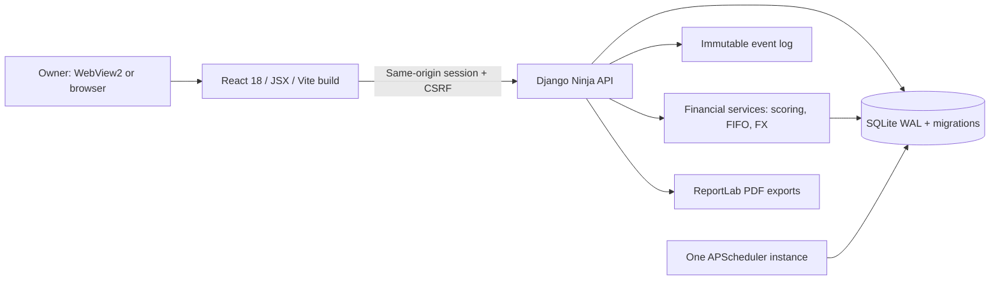

# KC Ledger: implemented architecture

KC Ledger is a private, **single-owner** financial operations application. Django is the sole source of financial truth; React displays real API data. There is no multi-tenant server, distributed queue, or bidirectional offline financial sync.

## Two supported launch modes

**Docker browser:** nginx serves the built React app, proxies `/api/` to a single Django/Gunicorn service, and binds on `127.0.0.1:8080`. The database persists in a named Docker volume. A host-only HTTP service must not be exposed publicly without a separate designed and verified TLS/network security boundary.

**Windows native:** `desktop/main.py` starts Django/Waitress in the same process, binds to `127.0.0.1` on an ephemeral port, applies migrations after backing up the existing database, initializes the owner on first launch, runs the scheduler once and opens a pywebview WebView2 window. SQLite, logs, and backups are stored in `%LOCALAPPDATA%\KCLedger`.

## Critical invariants

1. Backend uses Python `Decimal` for currency amounts; payment allocations and write-offs are guarded by database transactions.
2. Clients, invoices, engagements, work records, FX rates and targets are persisted by Django; charts and counters must not substitute demo values on live paths.
3. Paid and partial invoice statuses follow actual recorded payments; written-off amounts must not appear as collectible balances.
4. A client health score is explainable and recomputed after relevant operations; schedulers should be started once, never per worker.
5. Audit events are immutable; work records use reversible soft archives.
6. Sessions and unsafe API mutations use cookie authentication and CSRF; API request limits, a persistent login throttle and localhost binding are enforced.
7. SQLite's online backup API and guarded offline restore are the recovery mechanism; filesystem copying of an active WAL database is not a backup strategy.

## Production distinction

Passing unit tests, Chromium E2E, Docker boot and a Windows packaged executable self-test does not certify a clean-Windows installation or the third-party FX provider. See [release checklist](21-production-readiness.md) and [test matrix](24-verification-matrix.md).

_Updated 2026-11-15._
