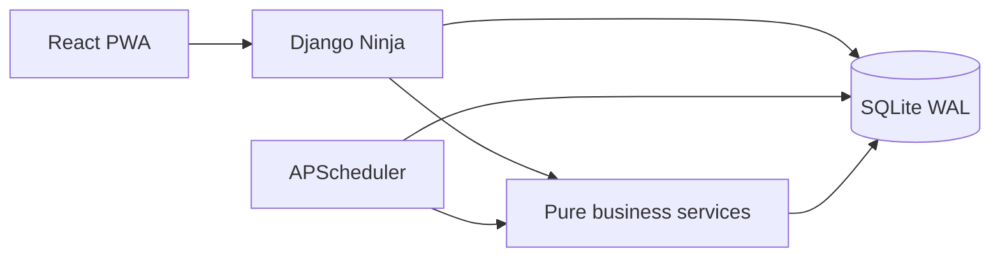

# Architecture

KC Ledger is a private single-user financial console. The React/Vite PWA presents screens; Django Ninja exposes typed same-origin JSON endpoints; Django services own calculations and mutations; SQLite WAL stores the durable records. APScheduler runs bounded in-process jobs. The browser caches the application shell only, never API responses or financial records.

## Request flow

A screen uses a view-shaped endpoint. Client detail returns the score breakdown, invoices, payments, engagements and timeline together. Financial writes execute inside database transactions, emit append-only events and recalculate the affected client score. UI queries are invalidated after successful mutations.

## Runtime boundaries

- **UI:** display, input validation, loading/error/empty states and interaction.
- **API:** authentication, request validation, authorization and transaction boundaries.
- **Services:** deterministic score, FIFO allocation and plan-verdict calculations.
- **Database:** constraints, foreign keys, indexes, audit records and soft-delete state.
- **Jobs:** overdue state transitions, reminders, silence signals, recurring drafts and optional FX refresh.

## Changelog
- 2026-10-28: Documented the initial server-authoritative architecture.
