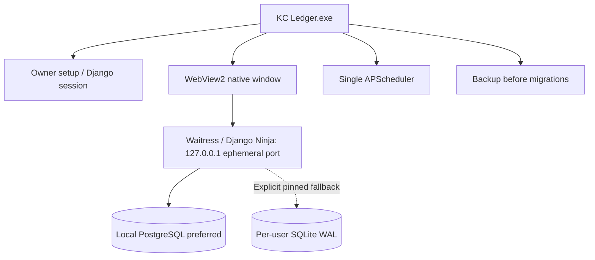

# Windows desktop application architecture

KC Ledger is one process containing the existing Django financial backend, Waitress (loopback-only) and a pywebview/WebView2 React/JSX window. Django remains authoritative for validation, security, calculations, audit and PDF.

On launch, the host reads `%LOCALAPPDATA%\KCLedger\.env` and OS environment variables, then selects the backend. In `auto` mode, new installs prefer local PostgreSQL, but if unavailable with permitted fallback they use SQLite. Once selected, the choice is **pinned** in `%LOCALAPPDATA%\KCLedger\.database-backend`; PostgreSQL recovery will not silently replace a SQLite ledger. Existing SQLite installs preserve their database until a deliberate migration.

The app stores signing key, app logs, backup archives and SQLite fallback data under `%LOCALAPPDATA%\KCLedger`. PostgreSQL mode uses `pg_dump/pg_restore` client tools installed with the user's PostgreSQL server (or `LEDGER_PG_BIN`) for pre-upgrade protection. In SQLite mode it uses the native snapshot API.

The native app is built using PyInstaller + Inno Setup, shipping Python modules including psycopg and the React production bundle; only PostgreSQL server/client tools are separate optional local dependencies. The default SQLite fallback works without PostgreSQL on a new machine.

Clean Windows 10/11 installation, first-run credentials, selected-backend accuracy, migrations, backup/restore, restart and publishing/signing remain independent device-acceptance gates. A frozen executable self-test does not prove real-device connectivity.

_Updated 2026-11-15._
