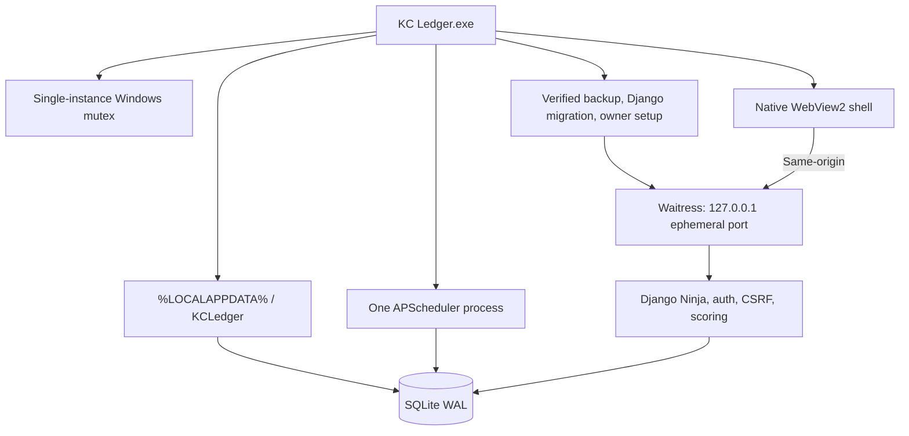

# KC Ledger desktop architecture — implemented

The desktop application **does not reimplement accounting logic**. `desktop/main.py` hosts the existing Django Ninja API and React/JSX build in one process, with Waitress on a loopback-only socket and a pywebview WebView2 native window.

## Actual lifecycle

1. Acquire single-instance mutex and open rotating application log.
2. Resolve `%LOCALAPPDATA%\KCLedger`, create/read a persistent random session key and point SQLite/backup paths at the per-user directory.
3. Run an online database backup before migrating an existing database. Apply migrations and create the first staff owner through a password-validated dialog when no owner exists.
4. Start Waitress at `127.0.0.1` on an ephemeral port and require an HTTP health response before showing the window.
5. Start the scheduler once, open WebView2 with the production React build and serve same-origin API routes.
6. On normal window exit stop the scheduler, close Waitress and release the mutex.

## Packaging and security

`desktop/build_windows.ps1` uses npm, PyInstaller, collected Django static assets, templates, migrations, and the portable **ReportLab** PDF renderer. It invokes Inno Setup when available and bundles the signed Microsoft WebView2 bootstrapper. The previous statement that the app requires WeasyPrint/GTK is **obsolete**.

The desktop is intended for Windows 10/11 x64; Android/iOS are PWA/browser views, not native installations from this script. The app stores sensitive unencrypted data in the OS user's application-data directory; protect the Windows account and backups. The listener must never be made externally reachable by a convenient configuration change.

## Known limits

The current CI Windows job builds the installer and exercises a frozen executable self-test for migrations, API, payment, PDF and SQLite persistence. It **does not** click through Inno Setup, complete interactive WebView2 financial journeys on clean Windows machines, or establish publisher trust. Those checks remain mandatory before distribution.

See [Windows packaging](23-windows-desktop.md), [production release runbook](21-production-readiness.md), and [verification matrix](24-verification-matrix.md).

_Updated 2026-11-15 to describe code actually implemented._
