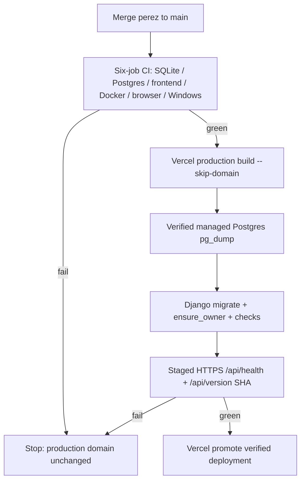

# KC Ledger release engineering: Vercel + signed Windows

## Status and release invariant

One canonical `VERSION` at repo root determines the Django, Node build and Windows installer version. Commit SHA, UTC build time, stable/beta channel and minimum supported version are generated by `scripts/build_metadata.mjs` and exposed by `GET /api/version`. The source of truth is **not** package.json, pyproject.toml or the Inno script.

**Non-negotiable:** Never promote a web build without a passing six-job CI and a verified production database backup/migration. Never download/execute a Windows installer without SHA-256, trusted Authenticode publisher pin and embedded-version checks. SQLite pinning is respected; changing versions never silently switches databases.

## First-time Vercel connection (operator configuration)

1. Create a **managed production PostgreSQL instance** (Neon, Supabase or RDS) with a secure TLS URL and connection pooler. No local or Docker SQLite in serverless.
2. In Vercel, create/link project **kc-ledger** to GitHub `PerezChris99/kc-ledger`, root `./`, Vite framework. Git integration can produce PR previews, but **must not auto-assign the production domain before CI/migrations**. Set Vercel production promotion to gated deployment workflow / Deployment Checks; disable direct main auto-aliasing.
3. Configure protected GitHub production environment variables `LEDGER_BACKUP_AWS_ROLE_ARN`, `LEDGER_BACKUP_AWS_REGION`, `LEDGER_BACKUP_S3_URI` (private S3 prefix), and `LEDGER_BACKUP_KMS_KEY_ID`. Grant the role only write/head permissions to that backup prefix, required KMS rights, and enable GitHub OIDC trust for the protected environment. A runner-local backup alone is **not durable** and deployment will refuse to migrate without offsite verification.

3. Add to Vercel Production scope: `DATABASE_URL` (managed pooled Postgres URL with `sslmode=require`), `DJANGO_SECRET_KEY` (unique 40+ chars), `DJANGO_DEBUG=0`, `DJANGO_ALLOWED_HOSTS` (explicit production domain), `DJANGO_CSRF_TRUSTED_ORIGINS` (HTTPS domain), `CRON_SECRET` (random 32+ characters), `LEDGER_USERNAME`, `LEDGER_PASSWORD` (owner bootstrap). **Do not commit any credential.** Configure Preview with **separate test database and different credentials**; never point previews at production financial records. `LEDGER_DB_ENGINE=postgres` and `LEDGER_DEPLOYMENT=vercel` are enforced by code.
4. In GitHub, protected `production` environment: secret `VERCEL_TOKEN`, vars `VERCEL_ORG_ID`, `VERCEL_PROJECT_ID`, a reviewed exact `VERCEL_CLI_VERSION`. Enable required reviews / restrict deployment to `main`. Set repository var `KC_LEDGER_VERCEL_READY=true` **only after** all deployment secrets and production controls are installed and verified. GitHub pipeline is deliberately inert before that flag.
5. Confirm project's Vercel Git integration allows PR previews and protected production deployment flow. `vercel.json` routes static Vite output to CDN, the Django WSGI function under `api/index.py`, and an authenticated scheduled cron endpoint. Validate routing and secure session cookies on the actual Vercel URL before broad access.

## Web pipeline

The GitHub Actions `Gated Vercel production deployment` runs on successful CI `workflow_run` for the exact current `main` commit (SHA lease prevents promoting a stale run). It stages a **production** deployment without assigning domains, pulls production environment in a protected runner, creates a verified `pg_dump` backup, uploads it to configured private KMS-encrypted S3 via short-lived GitHub OIDC credentials, verifies uploaded SHA-256 metadata, then migrates, health-checks staged code and promotes it. If durable backup upload or KMS checks fail, migration and promotion stop. Temporary production environment files and backup archives are never uploaded as artifacts. The previous version remains live until promotion.

**Schema compatibility:** new migrations must be backward-compatible with the old live code (expand → migrate → contract). Old serverless functions can still serve during migration. Never use destructive migrations in the same release as a code change that depends on them. Back up and run restore drills separately.

**Vercel limitations:** no built-in APScheduler on Functions. The single daily Vercel Cron GET `/api/internal/cron/daily` requires `Authorization: Bearer CRON_SECRET` and a PostgreSQL advisory lock to avoid concurrent schedule runs. The cron executes reminders, retainer drafts, ghosting and FX refresh. It may exceed the provider plan's duration cap with very large data sets; monitor failures/latency and move to a dedicated worker if needed. Session pooling belongs to a provider-side transaction pooler; Django Vercel connections use `CONN_MAX_AGE=0`.

## Windows signed release flow

1. Merge and verify `main` fully, and update root `VERSION` deliberately using SemVer. Tag **that merged commit** `vX.Y.Z`. No automatic installer releases on normal commits.
2. Configure protected GitHub `production-release` environment: `SIGN_CERT_PFX_BASE64`, `SIGN_CERT_PASSWORD` secrets and nonsecret publisher thumbprint var `KC_LEDGER_SIGNER_THUMBPRINT`. Certificate must be trusted on recipient Windows systems. Set `KC_LEDGER_MANIFEST_URL` (optionally the Vercel domain `https://<domain>/downloads/latest.json`), `KC_LEDGER_MIN_SUPPORTED_VERSION`, `KC_LEDGER_ROLLOUT_PERCENT` 0–100, `KC_LEDGER_RELEASE_CHANNEL` stable/beta. **No PFX/private key in repo or uploaded artifacts.**
3. Workflow `Signed KC Ledger Windows release` reuses full CI, builds the installer, signs it using SignTool + timestamp, verifies its certificate against the pinned publisher, exercises a clean silent install, bundled financial self-test and silent uninstall, then publishes GitHub Release assets:
   - `KCLedger-Setup-X.Y.Z.exe` (signed)
   - `KCLedger-Setup-X.Y.Z.exe.sha256`
   - `latest.json` (public, contains URL/hash/channel/minimum/rollout/notes/published time)
4. `/downloads/latest.json` on the Vercel domain is a read-only, short-cached mirror of the newest published **stable** GitHub release manifest; `/downloads/beta.json` mirrors prereleases. It never includes DB credentials or private installer paths.

The desktop updater reads the **bundled pinned certificate thumbprint**, not the manifest's signature claim, and rejects unknown publishers, unsigned downloads, hash mismatches, unexpected GitHub URLs, version mismatches, non-HTTPS downloads and downgrades. A random per-install ID is deterministically assigned to rollout buckets. The owner may choose `manual`, `auto_download` or `install_on_exit`. Changes require a deliberate app restart; data and `.env` are outside the installation directory.

## Installer migration, recovery and known failure modes

On an in-place upgrade the old packaged application is invoked with `--prepare-upgrade` **before** Inno overwrites files. It copies the prior binary bundle to `%LOCALAPPDATA%\KCLedger\rollback\previous-program` and creates a verified PostgreSQL `pg_dump` or SQLite online backup. Missing PostgreSQL client tools, missing permissions or a failed backup **abort the upgrade**.

After file replacement, Inno invokes `--post-upgrade-check` on the newly packaged backend. It migrates and checks the same pinned DB. If it fails, Inno calls `--restore-upgrade` on the protected database snapshot and copies saved previous binaries back. **A hard power loss or Windows crash mid-copy is not fully atomic**; inspect `%LOCALAPPDATA%\KCLedger\logs\update.log` and use the preserved backup and binaries. Never claim power-loss-proof atomicity from an Inno script alone. Test repeated/crashed upgrades on disposable real Windows 10/11 machines before distribution.

To roll back the web deployment, stage/promote the previous compatible Vercel build or use Vercel rollback to its prior stable URL. **Do not auto-rollback a destructive DB migration**. To halt desktop distribution, set rollout to 0 for a new release, unpublish a bad signed release, or repoint latest manifest only through controlled release publication; running clients never accept a lower version as an update.

## Outstanding external acceptance (not code)

- Actual Vercel project/GitHub Git connection, managed Postgres, secure DNS/domain and configured scoped secrets.
- Tested production restore and expand/contract migration across two web versions.
- Trusted Authenticode publisher certificate, GitHub release signing secrets and publisher trust on recipient machines.
- Interactive clean-Windows UI install/upgrade/restore, including user-data retention, WebView2, interrupted migration and local PostgreSQL.
- Web/desktop authentication and session cookies against actual deployed domains; update rollout at 0%, partial and 100%; full end-to-end financial reconciliation.

**No real Vercel deployment, release or code signing occurs until those external dependencies are configured.** 
