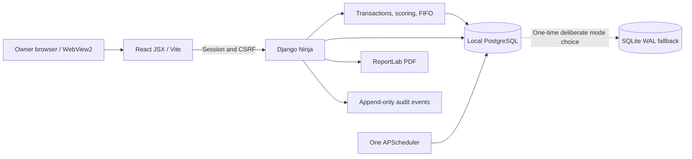

# KC Ledger — implemented architecture

KC Ledger is a single-owner financial operations system. React (JavaScript/JSX) reads live Django Ninja endpoints; Django owns transactions, authorization, scoring and persistence. **Local PostgreSQL is authoritative by default.** SQLite WAL remains an explicit fallback for offline desktops or isolated development. No cross-database synchronization or multi-tenant service exists.

## Runtime variants

**Local source:** Django connects to the owner's PostgreSQL listening on `127.0.0.1:5432`, with dedicated credentials from the repository-root `.env`. A successful `db_status` probe proves a live connection.

**Docker:** a local PostgreSQL 15 container (`db`) and Django container (`api`) share an internal Compose network; PostgreSQL is **not published** on host port 5432. `ledger_pgdata` persists data; the API uses `LEDGER_DB_ENGINE=postgres` and refuses silent fallback.

**Windows native:** a single pywebview + Waitress host selects PostgreSQL or pinned SQLite according to per-user configuration and whether PostgreSQL is reachable. Existing SQLite data is detected and preserved. The backend never silently swaps data stores when the chosen store goes offline.

## Database and security invariants

- PostgreSQL settings enable 60-second persistent connections with health checks, 3-second connect timeout, bounded SQL statement duration and transaction-idle limits; these values are configurable.
- Financial amounts use Decimal, FK constraints, indexed status/date columns and database transactions; creation/updates emit audit records atomically.
- A successful `/api/health` **requires** an actual `SELECT 1` against the configured authoritative database; it returns 503 when that database is unavailable.
- Django sessions, payments, allocations, events, targets and scheduled jobs use only the active backend. No client-facing fake data or split-brain offline writes.
- PostgreSQL backups use `pg_dump` custom archives; SQLite backups use the native online backup API. Restores are explicit and require operator confirmation.
- The former SQLite-only architecture is historical. See the [migration and fallback runbook](../operations/postgresql-and-fallback.md).

_Updated 2026-11-15._
