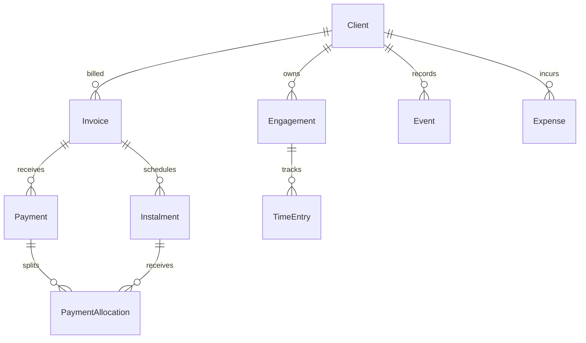

# KC Ledger data model and PostgreSQL operation

The same Django migrations and models run on PostgreSQL 15+ (default) and SQLite (fallback). Financial tables include clients, engagements, invoices, instalments, plan metadata, payments, allocations, work entries, expenses, events, signals, targets, FX rates and settings metadata. Django's authentication/session tables live in **the same active database**.

Amounts and prices use Django Decimal fields, not floating-point money. Rows are constrained by foreign keys, unique invoice numbers, positive-payment/expense constraints, live instalment sequence uniqueness and bounded client health scores. Django's standard migrations create the appropriate PostgreSQL constraints/indexes without handwritten SQL.

**Performance:** payment totals for revenue targets are grouped in SQL by invoice currency; FX conversions reuse a bounded exchange-rate lookup. Django enables PostgreSQL connection reuse (`CONN_MAX_AGE`) and health checks. Indexes are defined in `backend/ledger/models.py`.

**Fallback safety:** SQLite WAL is a completely separate database. SQLite data is not copied into PostgreSQL by changing connection settings. Migration must be performed offline with a verified backup and reconciled counts and totals. See [PostgreSQL runbook](../operations/postgresql-and-fallback.md).

_Updated 2026-11-15._
