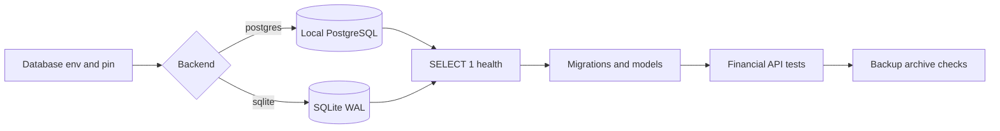

# KC Ledger verification matrix

| Layer | Automated check | Operator acceptance |
| --- | --- | --- |
| JavaScript/JSX frontend | ESLint, Vite build, Playwright Chromium financial paths | Keyboard, responsive and full feature UX |
| Django + SQLite fallback | Django check, migration validation, full pytest | Legacy ledger data recovery |
| **Django + PostgreSQL primary** | New PostgreSQL 15 service, real connection probe, migrations, full pytest suite | Connection to **your own** local PostgreSQL installation |
| PostgreSQL backup | Actual `pg_dump -Fc`, archive validation, restore dry-run in CI | Full offline restore drill into disposable database |
| Backend selection | Pin/fallback/legacy data protection unit tests | Unavailable PostgreSQL, credentials, restart and backend history |
| Docker | Local PostgreSQL health, Django health, Chromium client/invoice/payment workflow | Database volume retention and host network policy |
| Windows desktop | PyInstaller/Inno build and native SQLite smoke | Local PostgreSQL startup, offline fallback, upgrades and signed installer |
| Financial integrity | Decimal, FK/constraints, scoring and FIFO payment tests | Reconcile your actual balances and PDF outputs |
| Security | Django staff/CSRF/throttle, Python/npm advisory review | Windows OS, disk, network, permissions and backup protection |

All status claims require a completed CI run at the **current commit**. Historical green runs do not certify later database changes.

For the authoritative setup, migration and backup instructions see [docs/25](postgresql-and-fallback.md).

_Updated 2026-11-15._
